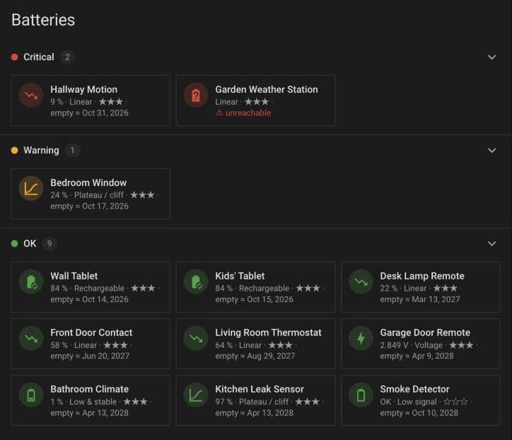
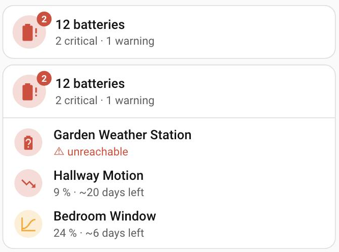
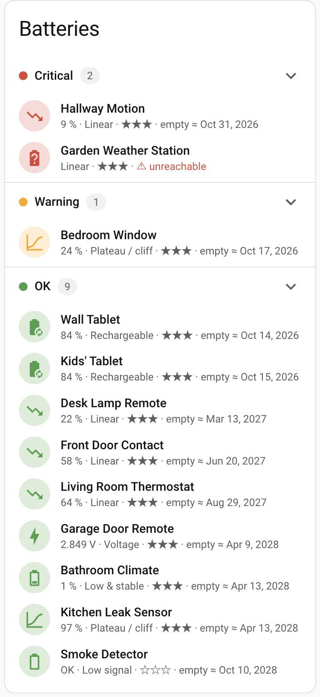
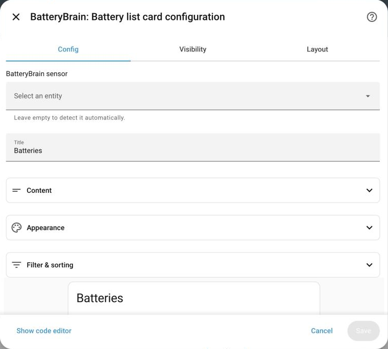

# BatteryBrain

[![GitHub Release][releases-shield]][releases]
[![GitHub Activity][commits-shield]][commits]
[![hacs][hacsbadge]][hacs]


**Intelligent battery monitoring for Home Assistant.** BatteryBrain finds every battery in your home on its own, learns how each one behaves, and tells you which ones really need attention — and when they will be empty.

> A coin cell that has been sitting at 1% for months is not an emergency. A sensor at 40% that loses ten points a day is. BatteryBrain knows the difference.

<p align="center">
  
</p>

---

## Why BatteryBrain?

Most battery setups in Home Assistant come down to one rule: *"notify me when a battery is below 20%."* Whether it's a blueprint, a template sensor or your own automation, that rule is wrong in both directions — it keeps alarming about batteries that are fine, and it stays silent about the ones that are about to die.

BatteryBrain looks at how each battery **behaves** instead of just its current percentage:

| | Fixed-threshold automation | BatteryBrain |
|---|---|---|
| **Setup** | Pick entities, write templates, keep them up to date | Nothing to configure — new batteries are picked up automatically |
| **Coin cell stuck at 1% for months** | Permanent false alarm | Recognised as "stays low", stays quiet until it really changes |
| **Sensor at 40%, draining fast** | Silent until it's too late | Warning days before it's empty |
| **Device went offline** (often the first sign of a dead battery) | Not noticed | Flagged after an hour |
| **A single bogus 0% reading** | Instant alarm | Waits for a second reading to confirm it |
| **"When will it be empty?"** | Unknown | Remaining days and an empty date for every battery |
| **Volts, on/off sensors, text levels** (`low`, `high`) | Separate rules for each | All in one place, rated sensibly |
| **Fresh install** | Starts from zero | Imports up to a year of history, works from day one |
| **Dashboard** | Extra frontend cards or templates | Two built-in cards, set up in the visual editor |

And if a simple threshold is all you want, BatteryBrain does that too: switch the alert mode to *Low level only* and keep the forecasts as extra information.

---

## Features

- **Finds all batteries by itself** — percentage sensors, voltage sensors, on/off battery sensors and (optionally) `battery_level` attributes
- **Learns each battery's behaviour** — rechargeable phone, coin cell, slowly draining door sensor or 9 V block: each kind gets its own rules
- **Clear status** — every battery is **Normal**, **Warning** or **Critical**
- **Remaining lifetime for every battery** — estimated days and date until empty, and where that number comes from
- **Offline detection** — devices that stopped reporting don't go unnoticed
- **Ready from day one** — uses your existing Home Assistant history instead of waiting weeks
- **Two dashboard cards included** — a compact summary and a full battery list, no extra downloads
- **Summary sensors** — for your own dashboards, notifications and automations
- **Fully local** — no cloud, no account, all data stays in your Home Assistant
- **One-click diagnostics** — everything needed for a bug report in a single download

---

## Installation

**Requirements:** Home Assistant 2025.8 or newer with the Recorder enabled (it is by default). HACS is recommended but not required.

### HACS (recommended)

[](https://my.home-assistant.io/redirect/hacs_repository/?owner=larsbaum&repository=battery_brain&category=Integration)

1. Open **HACS** in your Home Assistant instance
2. Click the three-dot menu (top right) **> Custom repositories**
3. Add this URL with category **Integration**:
   ```
   https://github.com/larsbaum/battery_brain
   ```
4. Search for **BatteryBrain** and click **Install**
5. **Restart** Home Assistant
6. Go to **Settings > Devices & Services > Add Integration** and search for **BatteryBrain**

### Manual installation

1. Download the [latest release](https://github.com/larsbaum/battery_brain/releases)
2. Copy the `custom_components/battery_brain/` folder into your Home Assistant `config/custom_components/` directory (replace the old folder completely when updating)
3. **Restart** Home Assistant
4. Go to **Settings > Devices & Services > Add Integration** and search for **BatteryBrain**

### Updating

Updates need no action: settings, entities and collected history are kept. (Exception when updating to 1.0: batteries read from a `battery_level` attribute start their history over once, because earlier versions recorded wrong values for them — see the [changelog](CHANGELOG.md).)

---

## Getting started

Adding the integration asks no questions — just confirm. From then on BatteryBrain:

1. **finds** all batteries in your system,
2. **reads their history** from Home Assistant (up to one year),
3. **learns** how each battery behaves,
4. **rates** each battery and **estimates** when it will be empty.

If your Home Assistant already has some history, most batteries are rated right away. Brand-new batteries need about a week of data before BatteryBrain knows their pattern; until then they get safe default rules.

Next, add the [dashboard cards](#dashboard-cards). Everything else can be adjusted later under **Configure** (see [Settings](#settings)).

---

## Alert modes

BatteryBrain offers two ways to decide when a battery needs attention. You can switch at any time; it takes effect immediately and no history is lost.

- **Smart (predictive)** — the default. Each battery is rated by how it drains: a coin cell sitting at 1% for months stays Normal, while a battery that will be empty within days becomes a Warning even at 40%. Best if you want to know *before* a battery runs out.
- **Low level only** — a battery becomes a Warning at or below a level you choose (default 10%) and Critical at or below half of it. Nothing else raises an alert. Best if you only want to hear about batteries that need replacing now.

In both modes, remaining lifetime and empty date stay visible. A few things are rated the same in both modes: unreachable batteries are always Critical (many devices switch off before they ever report a low level), voltage batteries are rated between their full and empty voltage, and on/off battery sensors keep their low-signal rules.

---

## Dashboard cards

BatteryBrain ships two dashboard cards. They come with the integration — no HACS frontend cards, no Lovelace resource to add.

To add one, edit a dashboard, click **Add card** and search for **BatteryBrain**. Both cards find the BatteryBrain sensor on their own, follow your theme and language (English and German), and every option is available in the visual editor — YAML is never required.

### BatteryBrain: Summary

A compact tile with the number of batteries and how many need attention. The icon takes the colour of the worst status, a badge shows the critical ones, and optionally the affected batteries are listed below.

<p align="center">
  
</p>

<details>
<summary><strong>Summary card options</strong></summary>

| Option | Default | Description |
|---|---|---|
| Name, Icon | automatic | Override the text (`12 batteries`) and the status icon |
| Counters in the second line | Critical, Warning | Which counts to show; optionally hide counters that are 0 |
| Badge | On | Number of critical batteries on the icon |
| Colour icon by worst status | On | Red / orange / green |
| Vertical layout | Off | Icon above the text |
| List affected batteries | Off | Lists the critical and warning batteries below the tile (worst first, up to a maximum) |
| Shown details | Value, unreachable, remaining time | Details of the listed batteries, same choice as in the battery list |
| Tap / hold action | More info / none | Any standard action, e.g. navigate to a dashboard with the full list |

</details>

### BatteryBrain: Battery list

All batteries grouped by status — Critical, Warning, OK — as a list or as tiles (see the screenshot at the top). Groups can be collapsed, tapping a battery opens its entity, and unreachable batteries are marked instead of showing an outdated value.

<p align="center">
  
</p>

<details>
<summary><strong>Battery list options</strong></summary>

| Option | Default | Description |
|---|---|---|
| Title | `Batteries` | Set when you add the card; leave empty for no header (in YAML: no `title`, no header) |
| Shown details | Value, type, confidence, unreachable, empty date | Any of: value, status, battery type, confidence (stars), unreachable marker, remaining time, estimated empty date, estimate source, entity ID |
| Status groups | All, OK collapsed | Which groups to show; group by status or show one combined list; hide empty groups; start with OK collapsed |
| Layout | List | *List* (rows like the entities card) or *Tiles* with 1–4 columns (one column on narrow screens) |
| Icon | By battery type | Archetype icon, or the battery entity's own icon |
| Sort by | Remaining time | Status, remaining time, value or name |
| Filter | — | Battery types to include; show, hide or show only unreachable batteries; maximum per group |

</details>

<details>
<summary><strong>Visual editor</strong></summary>

All options of both cards are grouped into sections in the visual editor.

<p align="center">
  
</p>

</details>

<details>
<summary><strong>YAML options (optional)</strong></summary>

```yaml
type: custom:battery-brain-summary-card
show_list: true
tap_action:
  action: navigate
  navigation_path: /dashboard-batteries
```

```yaml
type: custom:battery-brain-card
title: Batteries
layout: grid
columns: 2
fields:
  - last_value
  - remaining_days
  - estimated_empty
  - stale
```

All options with their YAML names: summary card `entity`, `name`, `icon`, `show_counts`, `hide_zero`, `show_badge`, `color_by_status`, `vertical`, `show_list`, `list_max`, `fields`, `tap_action`, `hold_action`; battery list `entity`, `title`, `fields`, `statuses`, `group_by_status`, `hide_empty`, `collapse_normal`, `layout`, `columns`, `icon_mode` (`category` / `entity`), `sort` (`status` / `remaining` / `value` / `name`), `categories`, `stale_filter` (`all` / `hide` / `only`), `max_per_group`. The `fields` values are `last_value`, `status`, `category`, `confidence`, `stale`, `remaining_days`, `estimated_empty`, `remaining_source`, `source_entity`.

</details>

The cards only read the [sensor attributes](#sensors), so you can still build your own cards from them.

---

## Sensors

BatteryBrain creates four summary sensors you can use in dashboards and automations:

| Entity | State |
|---|---|
| `sensor.battery_brain_all_batteries` | Number of monitored batteries |
| `sensor.battery_brain_batteries_normal` | Number of healthy batteries |
| `sensor.battery_brain_batteries_warning` | Number of batteries needing attention |
| `sensor.battery_brain_batteries_critical` | Number of batteries needing replacement |

Each sensor also carries the details of every battery in its group as attributes — status, value, battery type, remaining days, empty date and more.

<details>
<summary><strong>Attribute reference</strong></summary>

Each sensor has one attribute per battery in its group, named after the battery (if two batteries share a name, the entity ID is appended: `Name (sensor.xyz)`). It contains:

- `category` — the detected archetype (e.g. `linear`, `rechargeable`)
- `status` — current health status (`normal` / `warning` / `critical`)
- `last_value` — last reported battery level (% or V)
- `confidence` — classification confidence (`default` / `low` / `medium` / `high`)
- `stale` — whether the battery's entity has been unavailable for more than an hour
- `remaining_days` — estimated days until the battery is empty
- `estimated_empty` — the estimated date the battery will be empty (`YYYY-MM-DD`)
- `remaining_source` — where the estimate comes from: `measured`, `history`, `similar`, `typical` or `stale` (see [Remaining lifetime](#how-it-works))
- `source_entity` — the original entity ID

The sensors are `unavailable` while Home Assistant is starting, so automations don't see a misleading `0`. The per-battery attributes are not written to the recorder database (they would bloat it); the sensor states are recorded as usual.

</details>

---

## Settings

Open **Settings > Devices & Services > BatteryBrain > Configure**. The defaults work for most homes; the most common changes are excluding single batteries or whole integrations (e.g. phones from the Mobile App) and choosing the [alert mode](#alert-modes).

<details>
<summary><strong>All options</strong></summary>

| Section | Option | Default | Description |
|---|---|---|---|
| Discovery | Include `battery_level` attributes | Off | Also monitor entities that only report battery level as a `battery_level` attribute (sensors, binary sensors, device trackers) |
| Discovery | Include voltage sensors | On | Monitor voltage sensors between 0.3 V and 20 V as batteries. Turn off if non-battery voltages (e.g. an ESP board's 3.3 V supply) show up |
| Exclusions | Excluded integrations | — | Ignore all batteries of one or more integrations (e.g. Mobile App) |
| Exclusions | Excluded batteries | — | Ignore individual batteries |
| Alerts | Alert mode | Smart | *Smart (predictive)* or *Low level only* — see [Alert modes](#alert-modes) |
| Alerts | Warn at or below | 10% | Only for *Low level only*: Warning at or below this level, Critical at or below half of it (5–50%) |
| Alerts | Low signal of on/off battery sensors is critical | Off | Binary battery sensors become critical immediately instead of warning first |
| Advanced | Developer mode | Off | Debug logging and developer tools (see [Troubleshooting](#troubleshooting)) |

</details>

---

## How it works

BatteryBrain runs entirely inside your Home Assistant. In short:

1. **Discover** — every few minutes it looks for battery entities. New devices are added automatically, removed ones disappear.
2. **Remember** — it keeps its own compact history of every battery (one year), independent of the recorder, and notices when a battery was replaced.
3. **Learn** — after about a week of data it assigns each battery a *type* based on how it behaves (see below). The longer it watches, the more confident it gets.
4. **Rate** — each type has its own rules for Warning and Critical. A rechargeable at 15% means something different than a door sensor at 15%.
5. **Forecast** — it estimates when each battery will be empty: from the battery's own trend where possible, otherwise from its earlier batteries, identical devices in your home, or a typical lifetime for that kind of battery. Only forecasts from the battery's own trend can raise an alert.

### Battery types

| Type | Typical devices | Behaviour |
|---|---|---|
| **Linear** | Zigbee door/window sensors, motion sensors | Drains steadily over time |
| **Plateau-Cliff** | Coin cell devices (CR2032) | Stays near 100% for a long time, then drops sharply |
| **Rechargeable** | Phones, tablets, wall panels | Regular charge and discharge cycles |
| **Low-Stable** | Sensors reporting 1% for months | Stays low without really changing |
| **Voltage** | Devices reporting volts instead of % | Rated between full and empty voltage |
| **Binary** | Simple low/normal indicators | Only knows "low" or "normal" |
| **Unknown** | New batteries, devices kept in a narrow charge window | Not enough data yet, or no clear pattern — safe default rules |

### Technical details

Each section below explains one part in depth.

<details>
<summary><strong>Discovery: which entities count as batteries</strong></summary>

Every 5 minutes, BatteryBrain scans all entities for:

1. `sensor` entities with `device_class: battery`
2. `sensor` entities with `device_class: voltage` and values between 0.3 V and 20 V (mV is converted; mains voltage is filtered out). A voltage sensor that is already monitored stays monitored even when it becomes unavailable or drops out of the range
3. `binary_sensor` entities with `device_class: battery`
4. Optionally: `sensor`, `binary_sensor` and `device_tracker` entities with a `battery_level` attribute

Entities that nothing provides any more — left in the entity registry after a device, a YAML definition or an integration was removed (Home Assistant shows them as *unavailable* with `restored: true`) — are ignored after 15 minutes. Entities of an integration that is set up but fails to load stay monitored and become unreachable, because their batteries really can't be read.

BatteryBrain runs a second discovery pass after Home Assistant has fully started, because some integrations (Mobile App, Zigbee2MQTT, …) load later. Between scans, every reported value is processed immediately.

</details>

<details>
<summary><strong>History and storage</strong></summary>

- On first discovery, imports up to **365 days** of history from the HA recorder (Long-Term Statistics first, raw states as fallback). Batteries read from a `battery_level` attribute start without imported history.
- Stores the last **30 days** of raw data points (every value change; imported history at hourly resolution)
- Aggregates older data into **daily summaries** (up to 365 days)
- Remembers when batteries were replaced, even beyond 365 days (used for lifetime estimates)
- All data is stored locally in `.storage/battery_brain` — independent of the HA recorder
- Removing the integration deletes this history and the log files

</details>

<details>
<summary><strong>Classification: how the battery type is chosen</strong></summary>

Batteries are classified after 7+ days of data. The types are checked in this order (first match wins):

1. **Binary** — is it a binary sensor with `device_class: battery`?
2. **Voltage** — does it report in V or mV (without a unit: values between 0.3 V and 5 V)?
3. **Rechargeable** — are there gradual charge/discharge cycles? (Fast charging in imported hourly history counts too.)
4. **Low-Stable** — has the current battery been stuck at a low value with minimal variation, and not declining, for at least 30 days? (Readings of a replaced battery don't count.)
5. **Plateau-Cliff** — does it stay near max and then drop sharply?
6. **Linear** — is it steadily declining?
7. **Unknown** — fallback

Reclassification runs every hour. A change to a different type only takes effect once it was detected three times in a row, so borderline batteries don't flip back and forth.

**Confidence** grows with the amount of data: `default` (less than 7 days, fallback rules) · `low` (7–14 days) · `medium` (14–30 days) · `high` (30+ days).

</details>

<details>
<summary><strong>Status thresholds per battery type</strong></summary>

In the *Smart* alert mode each type has its own thresholds:

| Type | Warning | Critical |
|---|---|---|
| Linear | &le; 20%, or empty in &lt; 7 days | &le; 10%, or empty in &lt; 2 days |
| Plateau-Cliff | &le; 20%, or below its plateau and empty in &lt; 21 days | &le; 10%, or below its plateau and empty in &lt; 5 days |
| Rechargeable | &le; 15% | &le; 5% (Warning if it was recharged within its usual charge cycle) |
| Low-Stable | 3–10 points below its usual floor | More than 10 points below its usual floor |
| Voltage | &le; 25% between empty and full voltage | &le; 10% between empty and full voltage |
| Binary | Low signal | Low for 3+ days |
| Unknown | &le; 20% | &le; 10% |

A stale (unreachable) battery is always Critical.

**Plateau-Cliff:** leaving the plateau alone is no reason to warn. A coin cell at 85% that loses a percent every few days still lasts for months; the status follows the measured trend since the battery left its plateau. The horizons are longer than for Linear because the drain speeds up towards the end.

**Low-Stable and Unknown:** short dips are smoothed out — the comparison uses a high percentile of the last 36 hours instead of the single latest value.

**Low level only** alert mode: instead of the table above, Warning at or below the chosen level and Critical at or below half of it, for every type except Voltage and Binary. Short dips are smoothed out (except for rechargeables), and a rechargeable that was recharged within its usual charge cycle is only a Warning. Text levels `low` / `critical` / `empty` count like a binary low signal.

</details>

<details>
<summary><strong>Voltage batteries: full and empty voltage</strong></summary>

"Full" is the highest voltage of the current battery. "Empty" is the voltage at which the previous battery in this device ended. Until a replacement has been observed — and for sources that are recharged regularly, like a car battery charged by its alternator — a typical cut-off for the battery type is used:

| Full voltage | Typical battery | Assumed empty |
|---|---|---|
| up to 1.8 V | single AA/AAA cell | 1.0 V |
| up to 3.5 V | 2× AA/AAA, CR2032, CR123A | 2.3 V |
| up to 5.2 V | Li-ion / LiPo, 3× AA | 3.3 V |
| up to 7 V | 4× AA | 4.4 V |
| up to 10 V | 9 V block, 2S Li-ion | 6.6 V |
| up to 15 V | 12 V lead-acid / LiFePO4 | 11.8 V |
| above | — | 78% of full |

</details>

<details>
<summary><strong>Glitch filter: sudden drops are confirmed first</strong></summary>

A single reading that falls 30 points or more below the previous one (30% of the value for voltages) — some Z-Wave devices occasionally report 0% — only changes the status and remaining time once a second reading confirms it or after 2 hours. The value itself is shown right away.

</details>

<details>
<summary><strong>Remaining lifetime: where the number comes from</strong></summary>

Every battery gets an estimate. Where its own readings show a trend, the estimate is measured; otherwise BatteryBrain falls back step by step and tells you the source in `remaining_source`:

| `remaining_source` | Where the number comes from |
|---|---|
| `measured` | The battery's own trend since its last replacement (or recharge) |
| `history` | This device's own past: how long its previous batteries lasted, how fast it usually drains between charges, how long its low-battery signal used to last |
| `similar` | Other batteries of the same device model in your home (lifetimes, drain rates) — or, for lifetimes, of the same type |
| `typical` | A typical lifetime for this kind of battery minus the age of the current battery |
| `stale` | The battery is unavailable; the estimate is based on its last known value |

Only `measured` estimates ever change the status — Linear: below 7 days → Warning, below 2 days → Critical; Plateau-Cliff (once below its plateau): below 21 days → Warning, below 5 days → Critical. In the *Low level only* alert mode no estimate changes the status. `history`, `similar` and `typical` are informational and never trigger an alarm. Treat `typical` as a rough guide — it gets replaced by better sources as soon as BatteryBrain has seen enough of the battery.

</details>

<details>
<summary><strong>Remaining lifetime: measured estimates per battery type</strong></summary>

Readings are interpolated and resampled to a regular time grid first, so it doesn't matter how often a device reports, and time without a change counts as "no drain".

| Type | Measured from | Fallback when there is no trend |
|---|---|---|
| Linear | Trend over the current battery's life until 0%. Recent days count more, and if the drain is clearly accelerating towards the end, the recent trend is used | Freshly replaced, nothing dropped yet: drain rate of identical devices, previous lifetimes, or a typical lifetime |
| Rechargeable | Current discharge rate until 0%, blended with the typical rate of previous discharge phases. Time spent on the charger doesn't count | While charging: how long the current charge would last at the usual drain ("runtime without charging") |
| Voltage | Trend of the current battery until its empty voltage | No measurable drop yet: typical lifetime for the battery type × remaining charge |
| Plateau-Cliff | Once the value leaves its plateau: the trend since then | On the plateau: previous lifetimes in this device, of identical devices, or a typical lifetime minus the battery's age |
| Unknown | At least 7 days of a clear, steady decline | Devices kept charged (a tablet held between 40% and 60%, a robot vacuum in its dock): runtime without charging. Otherwise as Linear |
| Low-Stable | — (the reading is stuck) | Previous lifetimes, identical devices, or a typical lifetime minus the battery's age |
| Binary | — (only low/normal) | Normal: like Low-Stable. Low: how long the low signal lasted before the last replacement, or 30 days, minus the time it has been low |

</details>

<details>
<summary><strong>Remaining lifetime: typical lifetimes and text levels</strong></summary>

**Typical lifetimes** (used only when nothing better is known): Linear 540 days · Plateau-Cliff, Low-Stable, Binary 730 days · Unknown 365 days · Voltage by type (3 V cells such as CR2032 or 2× AA 730 days, others 365 days) · a rechargeable full charge without history: 2 days.

The age of a battery is counted from its last detected replacement; if none was ever seen, from when BatteryBrain first saw it. A battery older than its expected lifetime still gets at least 10% of it — it obviously still works.

**Text levels:** batteries reporting text (`low`, `medium`, `high`, …) are treated as 15 / 50 / 90 % (`critical` 5, `empty` 0, `full` 100).

</details>

<details>
<summary><strong>Remaining lifetime: how accurate is it?</strong></summary>

For steadily draining batteries the measured estimate is typically within a few percent. Many batteries — especially alkaline cells and coin cells — drain slowly for most of their life and then drop off quickly at the end. That final drop can't be seen in advance, so early estimates for such batteries are too long; they become accurate once the drop shows up in the data.

Very slowly draining batteries can show large values (several years) — that simply means the trend is nearly flat (capped at 100 years).

</details>

---

## Troubleshooting

<details>
<summary><strong>Some batteries are not discovered</strong></summary>

If a battery is missing:

1. Check that the entity has `device_class: battery` (or `voltage`) set — see [Discovery](#technical-details)
2. Enable **Include `battery_level` attributes** in the options — some integrations report the battery level as an attribute rather than a dedicated sensor
3. Make sure neither the entity nor its integration is excluded
4. Wait for the next scan (every 5 minutes)

</details>

<details>
<summary><strong>No batteries found after installation</strong></summary>

BatteryBrain runs a second discovery pass after Home Assistant is fully started, because some integrations (Mobile App, Zigbee2MQTT, etc.) load after BatteryBrain. If batteries are still missing after a few minutes, restart Home Assistant once more.

</details>

<details>
<summary><strong>The BatteryBrain cards are missing or show "Custom element doesn't exist"</strong></summary>

The cards are loaded by the integration itself, so they only appear once BatteryBrain is set up and Home Assistant was restarted after installing or updating it. If they are still missing, reload the page while bypassing the browser cache (in the companion app: *Settings > Companion app > Debugging > Reset frontend cache*).

</details>

<details>
<summary><strong>A battery is classified incorrectly</strong></summary>

Classification improves as more data comes in (see *Confidence* under [Classification](#technical-details)). A battery only switches to another type after the new pattern was detected three times in a row (about three hours).

If a battery is still misclassified after 30+ days, please [report it as an issue](https://github.com/larsbaum/battery_brain/issues) (see *Reporting issues* below).

</details>

<details>
<summary><strong>A battery shows as "critical" but is still working fine</strong></summary>

This can happen when:

- The battery reports very low percentages but is still functional (common with some Zigbee devices). BatteryBrain should eventually classify it as `low_stable` and stop alerting. In the *Low level only* alert mode it stays critical — that mode only looks at the level.
- The entity has been `unavailable` for more than an hour and the battery is marked as `stale`. Check whether the device is still online.

If the issue persists, please [report it](https://github.com/larsbaum/battery_brain/issues).

</details>

<details>
<summary><strong>Something that is not a battery shows up</strong></summary>

Usually a voltage sensor, for example the 3.3 V supply of an ESP board or a 12 V power supply. Exclude it under **Configure > Exclusions**, or turn off **Include voltage sensors** if you have no battery that reports a voltage.

</details>

### Reporting issues

If you encounter a problem, please [open an issue on GitHub](https://github.com/larsbaum/battery_brain/issues) and include:

1. **Which battery is affected** — the entity ID (e.g. `sensor.kitchen_motion_battery`) and what kind of device it is
2. **What you expected** vs. **what happened** (e.g. "classified as `rechargeable` but it's a CR2032 coin cell")
3. **The diagnostics file** — **Settings > Devices & Services > BatteryBrain**, three-dot menu, **Download diagnostics**

<details>
<summary><strong>What's in the diagnostics and log files</strong></summary>

The diagnostics file contains the settings, the current evaluation and the stored history of every battery (the point lists as compact JSON strings, so the file stays small enough to attach).

Optionally, attach the log files of the days the issue occurred:

```
config/battery_brain/logs/YYYY-MM-DD_batterybrain_logging.jsonl
```

They contain the reported values, classification changes and an hourly snapshot of every battery for the last 30 days.

> **Privacy:** Diagnostics and log files only contain battery entity IDs, names, values and classification data. No other personal information is included.

</details>

<details>
<summary><strong>Developer mode</strong></summary>

For advanced debugging, enable **Developer mode** under **Configure > Advanced**. This provides:

- **Debug log file** at `config/battery_brain_debug.jsonl` — verbose logging with full classification details
- **Test Mode switch** — for development only, accelerates time by 200× (destroys real sensor data — do not use in production!)
- **Reclassify button** — forces immediate reclassification of all batteries

</details>

---

## License

[MIT](LICENSE)

---

<p align="center">
  <sub>Made with battery-powered determination.</sub>
</p>

[releases-shield]: https://img.shields.io/github/release/larsbaum/battery_brain.svg?style=for-the-badge
[releases]: https://github.com/larsbaum/battery_brain/releases

[commits-shield]: https://img.shields.io/github/commit-activity/y/larsbaum/battery_brain.svg?style=for-the-badge
[commits]: https://github.com/larsbaum/battery_brain/commits/main

[hacsbadge]: https://img.shields.io/badge/HACS-Custom-41BDF5.svg?style=for-the-badge
[hacs]: https://github.com/hacs/integration
